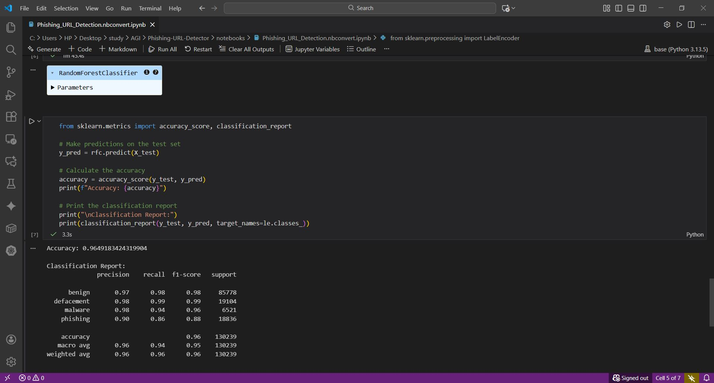

# Phishing URL Detector


A Python/Jupyter-based project for exploring and analyzing URLs to detect phishing or malicious links via static URL-feature extraction and classification experiments.

## 🚀 Overview

This project provides an environment to analyze lists of URLs — benign or suspicious — extract meaningful lexical/structural features, and use those features to study or experiment with detection logic. It is aimed primarily at learning, data exploration, and prototyping, rather than a finalized production tool.

## 📊 Results

- **Model:** RandomForestClassifier (100 trees, `random_state=42`)
- **Split:** 80% train / 20% test
- **Accuracy:** 96.49%
- **Test set:** 130,239 URLs — benign, defacement, malware and phishing



## 🧰 Project Structure

```text
Phishing-URL-Detector/
├── data/
│   └── malicious-urls-dataset.zip  # URL dataset (17.7 MB, contains malicious_phish.csv)
├── notebooks/
│   ├── Phishing_URL_Detection.ipynb
│   └── Phishing_URL_Detection.nbconvert.ipynb
├── Capture.JPG                     # Results screenshot
├── .gitignore
└── README.md
```

## 📝 What This Project Does (Current State)

- Loads URL data (from `data/`) for analysis.
- Via notebooks in `notebooks/`, extracts static features from URLs — e.g. length, domain characteristics, special characters, or patterns typical of suspicious URLs.
- Allows exploratory data analysis (visualizations, distributions) to inspect differences between legitimate and malicious/suspicious URLs.
- Trains a RandomForest classifier on the extracted features and evaluates it with accuracy and a classification report.
- Serves as a learning and prototyping base — ideal for experimenting with URL-analysis, understanding phishing characteristics, or building a baseline classifier.

## ⚠️ What It Is Not (Yet)

- There is no web-scraping, no content fetching, and no HTML rendering — detection is purely based on URL string features.
- There is no ready-made API or saved model file — the model is trained inside the notebook, not exported.
- It's not production-ready — no robustness guarantees, no real-time scanning, no security audits.
- It relies on manual datasets and assumptions; effectiveness depends heavily on quality of data and feature design.

## 🎯 Who This Is For

- Students and learners exploring cybersecurity, URL analysis, or data science.
- Developers/researchers prototyping phishing-detection logic, testing ideas.
- Anyone wanting to understand how static URL features can inform suspicious URL detection.
- As a foundation to build more advanced systems (e.g. integrating WHOIS data, SSL checks, web-content analysis, ML models, etc.)

## 🔧 How to Use / Getting Started

Clone the repo:

```bash
git clone https://github.com/MarcusABertli/Phishing-URL-Detector.git
cd Phishing-URL-Detector
```

Install the required packages:

```bash
pip install pandas scikit-learn jupyter
```

Unzip the dataset (the notebook loads `data/malicious_phish.csv`):

```bash
unzip data/malicious-urls-dataset.zip -d data/
```

Open the notebooks in `notebooks/` via Jupyter. Use them to load your datasets (or sample URLs), run feature extraction, and explore patterns.

Analyze outputs (tables, plots), inspect distribution of features between benign vs suspected URLs, and optionally implement classification logic (heuristics or ML) based on extracted features.

Optionally extend the project: add more URLs, more features (domain age, WHOIS, SSL status, content-based), or write scripts/modules to make detection reusable.

## 🚀 Possible Next Steps / Enhancements

Once you've explored the basics, you could extend the project by:

- Adding a feature-extraction module (in plain Python) to replace notebook-only logic.
- Integrating external metadata (e.g. WHOIS data, domain-age, SSL certificate checks).
- Fetching and analysing page content or HTML features (with caution).
- Building a simple command-line interface (CLI) or script to classify a URL list.
- Creating a web or desktop interface (e.g. Flask/Streamlit) so non-developers can use the detector.
- Compiling a clean, labeled dataset (benign vs phishing) for training and evaluation.
